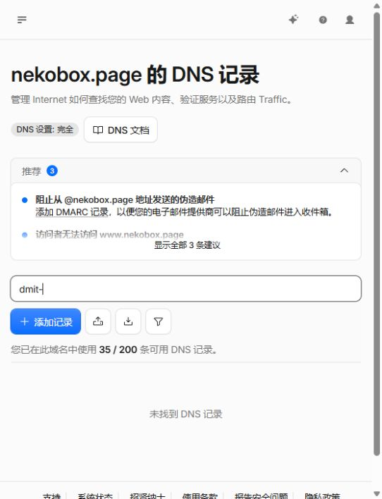
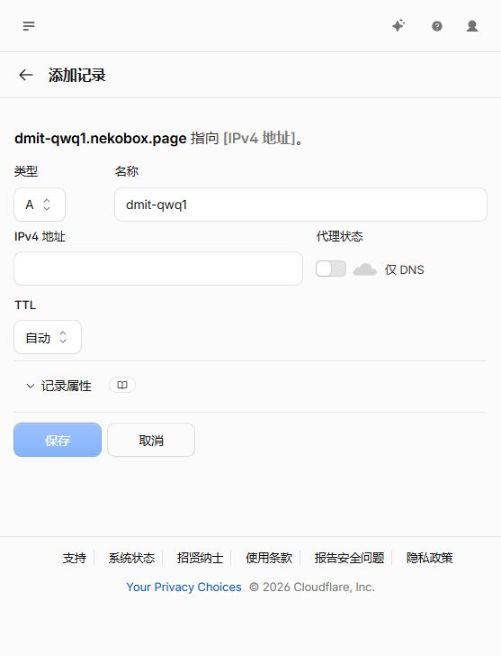
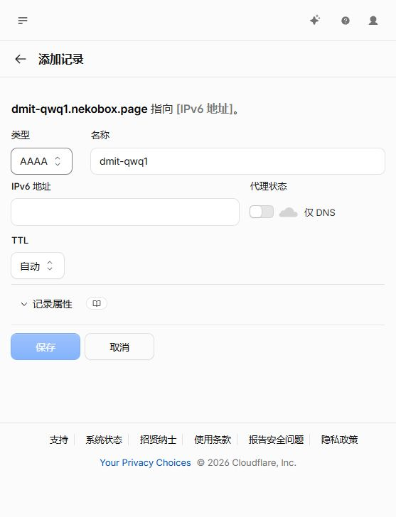
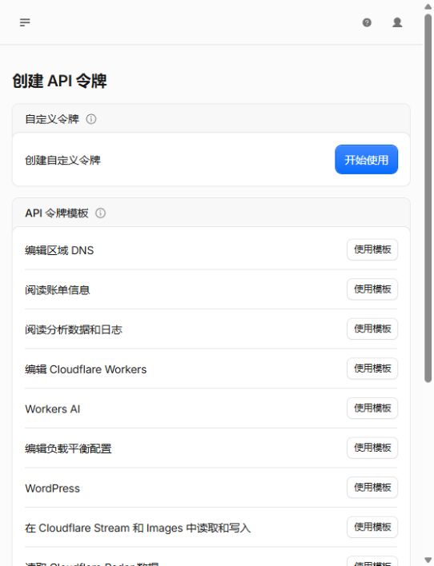
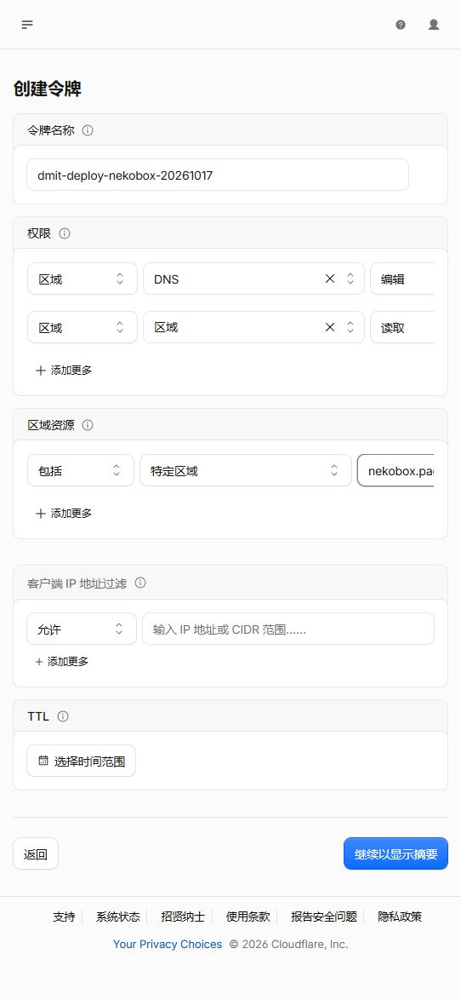
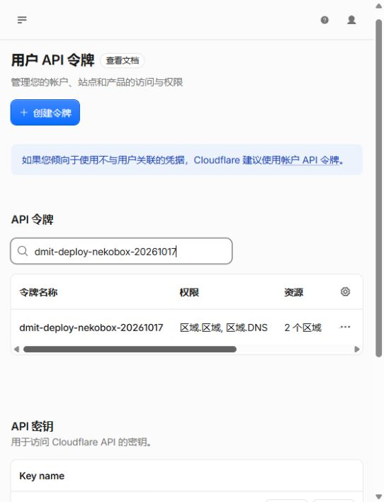
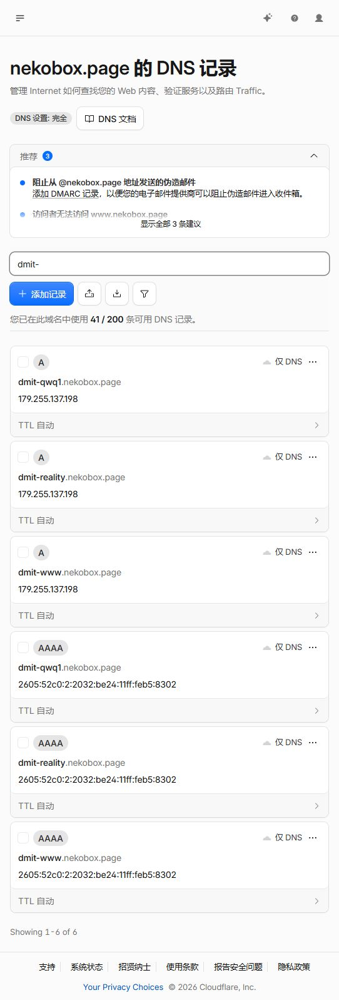

# Cloudflare 真实控制台截图

拍摄日期：2026-10-17。根据本轮部署要求使用 `nekobox.page`；截图来自已登录的真实控制台，不是示意图。早期 DNS 草稿地址输入留空，不能据草稿认定部署完成；下方上线证据展示已经公开的实际解析。

## 部署前检查

筛选 `dmit-` 后没有记录，表示这组名称在拍摄时尚未占用。完整解析检查仍由 deploy/API 和公开 DNS 查询执行。

## 灰云 A 与可选 AAAA

三个名称分别为 `dmit-qwq1`、`dmit-www`、`dmit-reality`；填入经盘点的真实 IPv4，使用「仅 DNS」。下图是未提交草稿。

有公网 IPv6 才添加同名 AAAA，否则留空并排除遗留 AAAA。下图也是未提交草稿。

## Token 模板与权限

从「编辑区域 DNS」模板开始，增加 Zone → Zone → Read，并把资源限定到实际使用的 zone。不要在教程或截图中保存 Token 真值。

此截图说明全新单 zone 部署的最小权限。保留旧域名、跨 zone SAN 证书时，按 [自动部署](automated-deployment.md) 中的跨 zone 说明审阅所有实际所需 zone；不能把单 zone 草稿当成跨 zone 授权已完成。

经操作者另行明确授权，已创建实际涉及的两个 zone 的 DNS Edit + Zone Read Token，有效期至 2027-10-17，并私密保存在目标 VPS。下图显示名称和范围数量，不含 Token 真值；Active 状态已通过控制台文本核实，API 读取预览成功。

## 授权执行后的真实解析

操作者另行明确授权具体生产计划后，Rust deploy 已通过 API 新增三组 A/AAAA，公开解析验证及证书/服务应用成功。下图为实际六条记录，全部「仅 DNS」，包括真实公开地址，不含客户端身份、私钥或 Token。

生产验证与尚未覆盖的场景见 [验收记录](defect/06-native-deployment-acceptance.md)。
