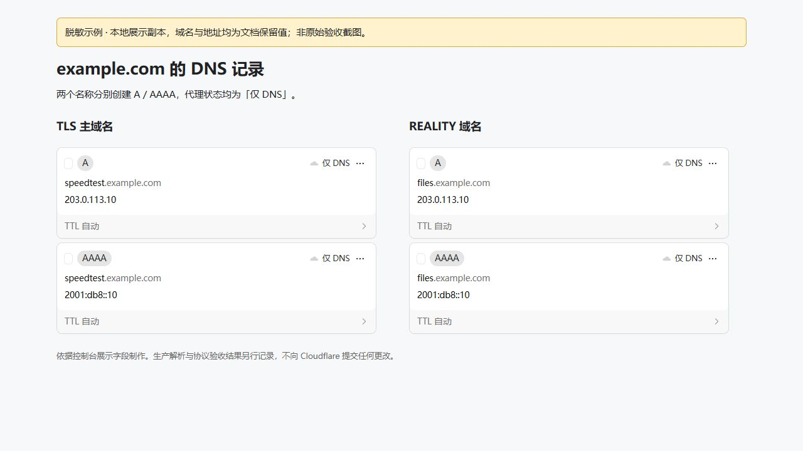

# Cloudflare DNS 配置图解

公开图片使用示例域名和文档保留地址。下图基于控制台当前展示区读取的 DOM 与样式制作本地静态副本，再替换展示文字并截图；原始页面和 Cloudflare 数据未修改。它是**脱敏示例**，不能当作真实 DNS 已配置的证据。真实原图与完整环境记录私密保存，不随仓库发布。

## 双域名与灰云

为 `speedtest.example.com`、`files.example.com` 分别创建 A；有可用公网 IPv6 时创建相应 AAAA。两者均为「仅 DNS」，TTL 自动。向导通过 API 完成操作并查询公共解析；手动配置应得到同样结果。

`203.0.113.10`、`2001:db8::10` 是文档保留地址，不能用于实际部署。没有 IPv6 时在向导中禁用，并处理冲突的旧 AAAA 后重新预览。

## API Token

Cloudflare 个人资料 → API 令牌 → 创建令牌，使用「编辑区域 DNS」模板，并添加 Zone → Zone → Read。资源仅包含实际使用的区域；自动识别 Zone 需要读取权限。新部署通常只需 `example.com`，跨区域保留旧 SAN 时必须包含所有实际区域。

Token 在向导中无回显输入，或使用 owner-only 的 `--token-file`。不放到命令参数、仓库、截图或聊天中。浏览器登录不能替代 API Token。

## 验证

控制台显示正确记录只是其中一步。部署还需要公共 A/AAAA 查询、受信证书和 SAN 校验、服务运行及真实协议握手；这些检查通过后才报告成功。

当前安装入口见 [首次部署](getting-started.md)，字段与自动化细节见 [交互部署](automated-deployment.md)，历史功能验收见 [0.3 记录](defect/07-neutral-udp-migration.md)。