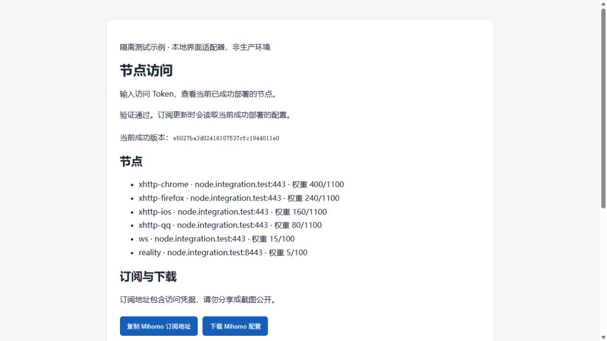

# 安全节点分发验收记录

日期：2026-10-18。结论：0.4.0 的本地门禁、Debian 13 隔离全流程及浏览器使用流程通过。v0.4.0 已正式发布，公开安装入口验证通过；未在生产 VPS 安装此功能，不应据此声称生产已有节点页面。

## 交付与逐项验证

| 要求 | 实现及实际证据 |
| --- | --- |
| 部署结果 | 健康检查成功后输出页面、两种订阅模板、凭据位置、状态与管理命令；PTY 向导实际完成部署、导出；取消不会创建凭据 |
| 随机与自定义 Token | 默认 OS 随机源 256 位；初始自定义及后续 rotate 支持无回显输入或受保护文件；单元测试检查长度、权限、记录完整性和轮换 |
| 安全显示与恢复 | 首次只经控制终端展示，stdout 只有占位符及私密路径；reveal 从私密记录取回；无终端不向日志输出真值 |
| Web 使用流程 | 实际浏览器验证错误 Token 拒绝、正确 Token 展示六个节点、两种地址复制及两种配置下载；刷新、清除凭据均返回登录页 |
| 客户端格式 | 浏览器两份下载 SHA256 分别与当前本地导出一致；真实 Mihomo HTTP provider 获取订阅并通过导入节点完成 HTTPS 握手 |
| 只分发成功版本 | API 持共享锁，验证 current、success 收据及完整快照；篡改、候选、事务阻塞均拒绝；再次应用与回滚后实际检查返回版本随成功 current 更新 |
| 立即轮换与撤销 | CLI 写入串行化；实际浏览器旧会话在轮换后下载被拒、撤销后复制被拒；API 不复用认证缓存；旧 Token 不因回滚恢复 |
| 退出时并发请求 | 页面 generation 检查阻止在途登录、下载重新显示内容；实际复制后立即退出、重新加载验证凭据不持久化 |
| 访问控制与限流 | HTTPS API 和下载未授权拒绝；Nginx 真实 IP 限流、连接限制及伪造转发头测试通过；后端仅私密 Unix socket，无新增公网监听 |
| 凭据泄漏防护 | 普通、错误、超长头、超长 URI、站点回退及 Referer 请求后扫描测试日志，无测试 Token；缓存、引用来源、CSP 和错误响应测试通过 |
| 私钥隔离 | API 调用现有客户端生成器；测试检查响应不含服务端 decryption、REALITY 私钥或 WARP 凭据；不提供任意文件读取接口 |
| 部署与恢复 | 十一个检查点故障恢复通过，包含新增 sharing；卸载中断、恢复重试、入口漂移拒绝、完整材料回滚通过 |
| 原服务接管 | 替代 state-dir 的实际部署、原分发服务接管和卸载恢复通过；原服务入口、运行状态及凭据摘要保持原值 |
| 旧版本与手动路径 | 官方 0.3.1 二进制生成的真实模板 2 快照由 0.4.0 成功严格校验；模板 1/2 冻结、未知版本与篡改仍拒绝；旧配置不隐式启用分发，本地 export 保留 |

## 测试方法与结果

- `bash scripts/check-all.sh`：格式、48 个主程序测试、2 个仓库工具测试、5 个 CLI 测试、所有目标及 feature 的 Clippy、Schema、文档链接、Shell/工作流检查、Python 零依赖门禁通过。默认跳过的 2 个上游内核测试已使用锁定 Xray / Mihomo 二进制单独执行，2/2 通过。
- 最终源码构建后启动新的 `nodectl-sharing-final` 隔离 systemd 容器，执行完整 `tests/integration/runtime.sh`，最终 `INTEGRATION_PASS`。测试使用 Debian 13、锁定 Xray 26.10.10 与 Mihomo v1.19.32。此前另一次标准驱动全流程亦通过；本结论以最终新容器为准。
- 两内核、三种传输分别验证 TCP HTTPS、UDP DNS、普通 UDP、多包往返、强制 HTTP/3 QUIC 与无 UDP 直连泄漏；24 个错误密钥、错误 flow、缺失加密及旧客户端负例拒绝通过。另验证 H2/H3、IP TLS、默认路由守卫与证书续期隔离 hook；WARP 配置禁止接管默认路由的校验和渲染回归通过。
- 故障检查点：五个入口、daemon-reload、sharing、xray、nginx、services、health；恢复后继续完成升级、回滚、卸载及自动部署材料恢复。
- 浏览器经只读本地适配器访问真实隔离 Nginx HTTPS 后端，后端校验测试 CA；静态页面为实际源码。适配器仅转发读请求并添加示例标记，不改变 Cloudflare 或生产资源。两个浏览器下载均与容器导出逐字节摘要一致。
- 真实 Mihomo HTTP provider 测试包含 HTTPS 获取、缓存内容与导出比较、经导入节点握手；Xray 格式按原有 outbound profiles 集合验证，不宣称通用手机客户端订阅兼容。

本机证据日志保留在忽略的 `dist/`：`share-final-gates.log`、`share-final-build.log`、`share-final-integration.log`、`share-original-031-snapshot.log`。测试脚本随源码提供；原始测试材料、凭据文件和客户端下载不作为公开报告附件。

截图为真实浏览器的隔离测试界面，不含 Token，不作为生产部署证据。

## 正式发布验证

[发行工作流](https://github.com/i0721/dmit-node-config/actions/runs/39089140049) 完成两个架构的 Debian 12 glibc 基线原生构建、归档检查、SBOM/许可收集、清单签名及构建证明验证。[v0.4.0 Release](https://github.com/i0721/dmit-node-config/releases/tag/v0.4.0) 已公开，且为 latest 稳定版，源码提交为 `94ad3a1c25bcf5cbe44450c260a19ea5da8c973a`。

| 正式归档 | SHA256 |
| --- | --- |
| amd64 | `1ebdd12b9a2de6dbde7dcf86f0dcfdecf46e1f8d1a5ae3806e7f833fdc60daae` |
| arm64 | `fc00a9fc86e9bc5407f7c0ea8dd69c16473c56e95e298a362f72095460358b90` |

从真实 raw main 地址重新下载安装器，在本地隔离目录运行工具安装模式，不指定版本，让安装器自动解析 latest。实际完成官方固定摘要 cosign、精确标签 OIDC 身份、清单、归档和程序版本验证，成功安装 `nodectl 0.4.0`，`share --help` 可用。日志为本机忽略文件 `dist/public-release-040-install.log`。此次验证没有操作生产服务；完整向导行为以此前隔离流程为证据。

## 安全审查与恢复边界

审查覆盖凭据存储、鉴权、HTTP 解析、页面状态、Nginx 日志、进程权限、快照校验、部署锁及卸载恢复。凭据在 root 私密目录独立保存；鉴权摘要恒定时间比较；HTTP 限长、超时、并发及输出大小；systemd 只读文件系统、私有网络，仅开放 Unix socket。页面不使用持久化存储、第三方资源、远端转换站或管理 API。

分发进程复用完整快照验证，因而以受限 root 服务读取受保护材料；这不等于进程从不读取服务端私钥，保证的是这些材料不会进入客户端响应。保持已有完整性验证，未为读取便利放宽权限。

关闭分发、退回旧监听或卸载时先撤销 Token，防止旧日志记录有效订阅参数。此撤销不可随失败恢复逆转；恢复后如需再次开放，显式 rotate。存在未恢复事务时接口暂停、管理写操作拒绝，先 recover。该行为在预览及用户文档明确说明。

已下载的节点身份无法通过分发 Token 撤销远程删除；若节点身份本身泄漏，需另行迁移节点身份。浏览器插件、用户剪贴板历史、客户端自身日志或外部网络设施不受项目控制，订阅地址应始终作为凭据保管。

## 未执行与后续上线条件

- 本次没有生产 DNS、证书、Nginx、systemd 或节点配置变更，没有上线 0.4.0，也没有清理旧 DNS。
- 本次未重跑其他发行版及 ARM64 的运行矩阵，不能以 Debian 13 成功代替其验收；未用未知手机客户端版本替代锁定内核验证。
- 本次未重新连接真实第三方 WARP 网络；本地配置及路由守卫测试不作为真实 WARP 出口证据。
- 生产环境验收尚未执行。若要上线，应提供正式资产摘要、变更、维护及恢复预览，再取得生产执行授权。
- GitHub 自动系统矩阵保持此前按用户要求关闭；本次完整回归在本地隔离环境执行，未恢复重复的自动 CI。
