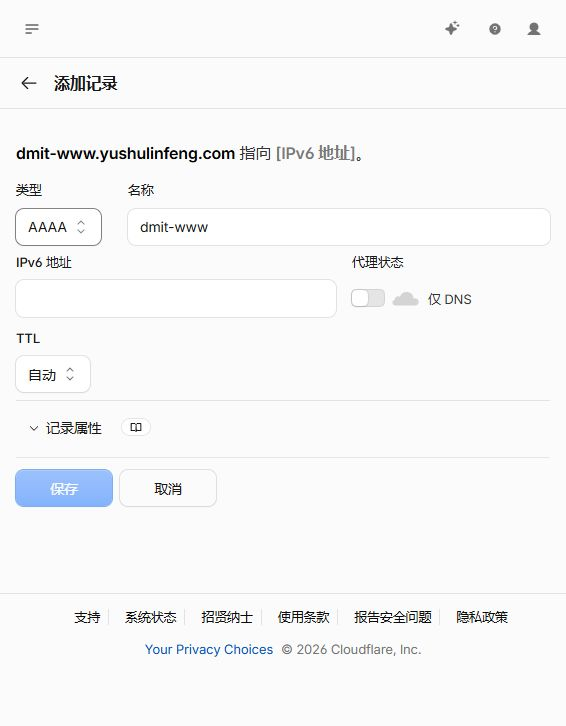
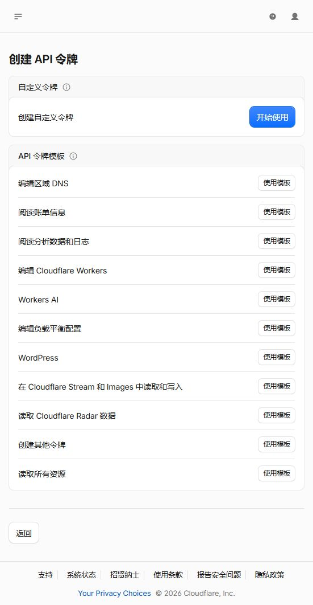
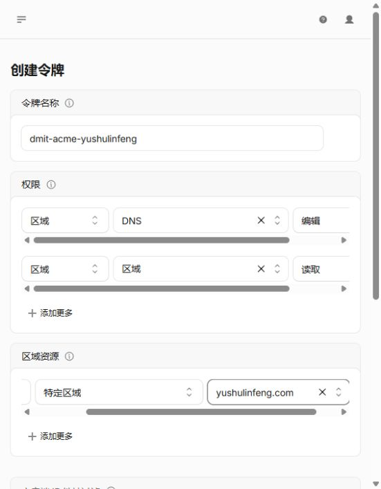
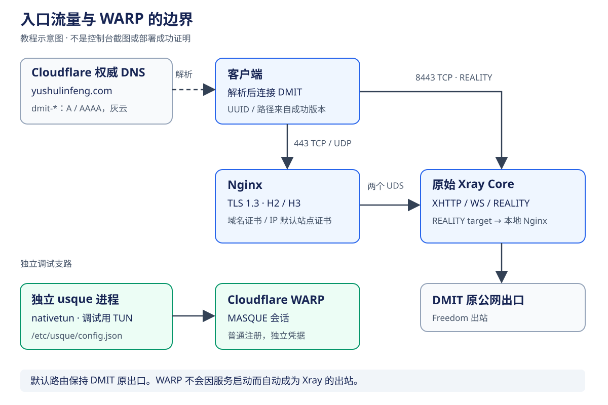
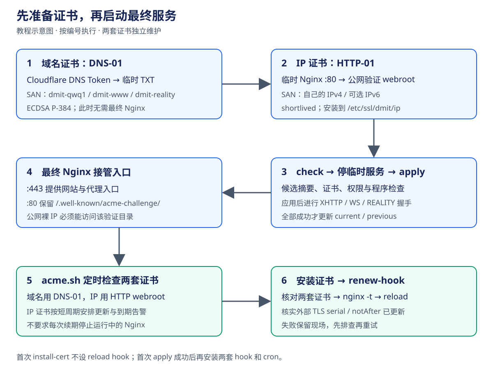

# 部署图解与资源索引

本页是 [完整部署教程](deployment.md) 的配套图解，按实际操作顺序查看。截图采集于 2026-10-16，来自 Codex 内置浏览器中的 Cloudflare 中文界面。当前窄窗口显示的是响应式布局；桌面宽屏的按钮位置可能不同，以控件名称和选中值为准。

## 补充前的分析

原教程具备命令、参数表及验收清单，但没有图片资源或图片引用。需要直观说明的重点有三类：

| 缺口 | 补充资源 | 阅读时要确认的内容 |
| --- | --- | --- |
| DNS 中如何选择灰云、区分 A/AAAA | 两张真实草稿截图 | 类型、名称、地址族、仅 DNS |
| Token 模板和权限选择容易混淆 | 模板入口与权限草稿截图 | DNS Edit、Zone Read、Specific zone |
| 多服务及证书的先后关系难以串起来 | 两张 SVG 示意图 | 流量边界、首次签发与长期续期顺序 |
| 部署结果只在聊天/终端中，难以交接 | 可复制的部署记录模板 | 实测证据、待办、日期、恢复路径 |

截图是操作指引，示意图解释设计关系；两者均不代表服务器或证书已经上线。

## 图 1：A 记录与灰云

对应 [部署教程第 2 节](deployment.md#2-cloudflare-dns-与域名接入)。按图核对：

1. 类型为 **A**，名称只填 `dmit-www`，界面自动补成 `dmit-www.yushulinfeng.com`。
2. 在 **IPv4 地址** 中填写自己的 DMIT 公网地址。截图故意留空，避免把真实地址或保留文档地址当作可复制配置。
3. 代理状态为灰云 **仅 DNS**，TTL 为自动。
4. 部署时填完并核对再保存；本截图的草稿没有提交，已取消。

`dmit-qwq1`、`dmit-reality` 使用相同的地址和代理策略，分别建立/核对对应记录。已有记录应编辑原记录，避免增加重复解析。

## 图 2：可选 IPv6 AAAA 记录

将类型选为 **AAAA** 后，地址输入框变为 IPv6。只有服务器具备可从公网验证的 IPv6 时才为三个名称添加 AAAA，并同步设置 node.toml、IPv6 防火墙和 IP 证书 SAN。没有 IPv6 就省略这一步；截图草稿没有提交，已取消。

## 图 3：DNS Token 模板入口

对应 [部署教程第 3 节](deployment.md#3-cloudflare-api-token)。进入用户个人资料 → API 令牌 → 创建令牌，选择 **编辑区域 DNS** 的「使用模板」。这里选择的是 DNS Token 模板，不是 Workers、账单或 Global API Key。

## 图 4：权限与单个 zone 范围

创建表单中应有两行：

| 资源类别 | 权限类别 | 级别 |
| --- | --- | --- |
| 区域（Zone） | DNS | 编辑（Edit） |
| 区域（Zone） | 区域（Zone） | 读取（Read） |

下方资源范围是 **包括 → 特定区域 → yushulinfeng.com**，不是所有区域。窄窗口有水平滚动条，最左侧「包括」可能需要横向滚动才能看到。

选择「继续以显示摘要」后，应显示 `yushulinfeng.com — DNS: 编辑，区域: 读取`。资源范围确认无误后，实际部署者才执行创建。本次只浏览配置和摘要，随后退出，**没有创建 Token**；摘要中的账户显示名及一次性秘密不作为教程截图保存。

截图中客户端 IP 过滤和 TTL 未填写。它们仍应按主教程选择：IP 过滤要匹配实际 API 出口；到期时间要与自动续期维护安排匹配。截图不是建议永久不设 Token 到期时间。

## 图 5：节点入口与 WARP 的关系

Cloudflare DNS 只返回 DMIT 地址；443 到 Nginx 后经两个 UDS 进入 Xray，8443 直接进入 Xray REALITY。Xray Freedom 使用 DMIT 原公网出口。usque 是独立的调试支路，启动 TUN 不会把 Xray 自动切换到 WARP。

这张图用于理解 [WARP 调试步骤](deployment.md#8-cloudflare-warp-与-usque)，不是控制台截图。TUN 名称、是否建立 MASQUE 会话、受控 trace 和默认路由都要在服务器实测。

## 图 6：两套证书的首次签发与续期

对应 [第 6–7 节](deployment.md#6-acmesh-与域名证书) 和 [第 11 节](deployment.md#11-无人值守续期与监控)。重点是先准备两套证书，再启动依赖它们的最终 Nginx。临时 HTTP 服务在 check 后退出，最终 Nginx 继续提供同一个 webroot；首次成功 apply 后才给两套证书配置 reload hook 和调度。

## 可保存和复用的资源

| 资源 | 用法 |
| --- | --- |
| [部署记录模板](resources/deployment-record.template.md) | 复制到服务器私密记录目录，填写实际证据；不把填写后的秘密提交仓库 |
| [完整普通参数示例](../config/node.example.toml) | 参考字段；init 后只编辑实际值，保留已经随机生成的路径 |
| [输入约束说明](../schemas/constraints.md) | 检查路径、端口、UUID、权重和 WARP 限制 |
| [图片来源与维护说明](assets/deployment/README.md) | 查看采集状态、图片用途与更新方式 |
| [网络图 SVG 原文件](assets/deployment/network.svg) | 可直接下载、缩放或放入内部运维资料 |
| [证书流程 SVG 原文件](assets/deployment/certificate-lifecycle.svg) | 可直接下载、缩放或放入内部运维资料 |

尚未取得真实服务器的终端截图，因此这里不展示伪造的“签发成功”“apply 成功”或 `warp=on` 结果。实际部署完成后，可按记录模板保存脱敏证据，再标注服务器环境、日期和工具版本。
